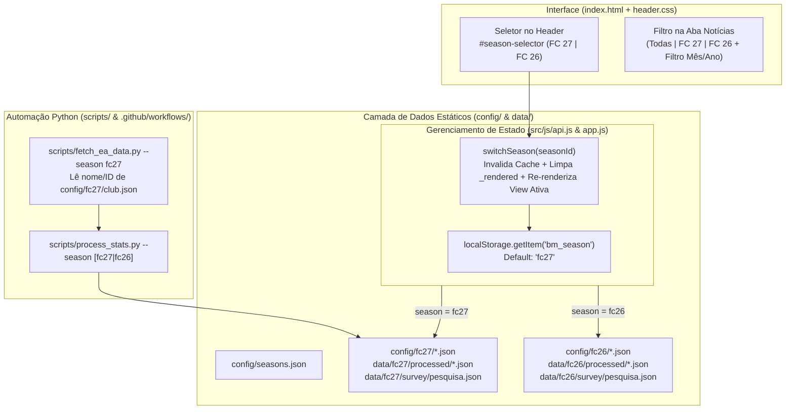

# 📋 Plano Técnico Detalhado: Compatibilidade Multi-Temporada (EA FC 26 & EA FC 27)

> **Documento de Especificação Técnica para Delegação entre Modelos/Agentes**  
> **Projeto**: Baile de Munique (`site-bm`)  
> **Status**: Aprovado para Execução — Especificação Exaustiva por Fase  
> **Referência de Mapeamento**: Consulte sempre o [`REPO_MAP.md`](file:///f:/BaileDeMunique/site-bm/REPO_MAP.md) na raiz do repositório antes de iniciar qualquer fase.

---

## 📋 Cabeçalho Padrão de Prompt (Copiar e Colar para Cada Agente)

Sempre que delegar uma fase ou bloco de tarefas para um agente, envie este cabeçalho no início do prompt seguido da seção da fase correspondente:

```markdown
# Contexto do Projeto — Site BM
- **Stack**: Aplicação Web SPA em HTML5 (`index.html` na raiz), CSS3 modular em 2 camadas (`src/css/pages/`, `src/css/components/` — arquivos com variáveis CSS em `src/css/main.css` e suporte nativo a Dark/Light Mode) e Vanilla JavaScript modularizado em ES6 Modules (`src/js/app.js`, `src/js/api.js`, `src/js/pages/`, `src/js/utils/`), além de pipeline ETL em Python (`scripts/`).
- **Protocolo de Navegação (`REPO_MAP.md`)**:
  - **SEMPRE consulte o arquivo `REPO_MAP.md` na raiz do projeto primeiro** para localizar arquivos, funções exportadas e faixas de linhas antes de abrir arquivos do projeto. Evite fazer buscas cegas ou varreduras recursivas no repositório.
  - **Regra de Governança Incremental**: Sempre que criar, mover ou renomear arquivos (`.css`, `.js`, `.py`, `.json`), adicionar/mover seções ou modais em `index.html` ou alterar assinaturas públicas de funções, você **DEVE atualizar o `REPO_MAP.md` e o `README.md` na mesma entrega**.
- **Boas Práticas de Versionamento Git (Branch por Feature & Conventional Commits)**:
  - **Nunca commite diretamente na `main`**: Antes de realizar alterações, verifique a branch atual (`git branch`). Crie ou mude para a branch da feature indicada na fase (`git checkout -b <nome-da-branch>` ou `git checkout <nome-da-branch>`).
  - **Conventional Commits**: Realize commits atômicos e semânticos seguindo estritamente o padrão *Conventional Commits* (`feat:`, `refactor:`, `style:`, `chore:`, `ci:`, `docs:`), utilizando a mensagem de commit sugerida na especificação da fase.

# Sua Tarefa Atual
Execute integralmente a [INSERIR FASE(S) OU BLOCO AQUI] descrita abaixo, seguindo estritamente os caminhos de arquivos, contratos JSON, padrões de código e instruções de Git especificados:
```

---

## 🧠 Matriz de Recomendação de Modelos, Raciocínio e Versionamento Git

> [!NOTE]
> **Estratégia de Branch Recomendada**: Você pode utilizar uma branch única para toda a feature (`feat/fc27-multi-season`) onde cada agente adiciona o commit da sua respectiva fase, **ou** criar branches específicas por fase/bloco e fazer merge na `main` ao final. Abaixo estão ambas as opções mapeadas.

| Fase / Escopo | Modelo Recomendado | Nível de Raciocínio | Branch Sugerida (Unificada ou Isolada) | Mensagem de Commit Sugerida (Conventional Commits) |
| :--- | :--- | :---: | :--- | :--- |
| **Fase 1**: Reestruturação de Pastas e JSONs (`config/` e `data/`) | **Gemini 3.8 Flash** | **Baixo (Low)** ou **Médio (Medium)** | `feat/fc27-multi-season`<br>*(ou `chore/fc27-data-structure`)* | `chore(data): estrutura diretorios multi-temporada para fc26 e fc27` |
| **Fase 2**: Camada de Dados (`api.js`) e Router SPA (`app.js`) | **Claude Sonnet 5.5** ou **Gemini 4 Argon** | **Médio (Medium)** | `feat/fc27-multi-season`<br>*(ou `feat/fc27-core-router`)* | `feat(core): adiciona suporte multi-temporada na api e router spa` |
| **Fase 3**: Seletor de Versão no Header (`index.html` + `header.css`) | **Gemini 3.8 Flash** | **Baixo (Low)** ou **Médio (Medium)** | `feat/fc27-multi-season`<br>*(ou `feat/fc27-header-selector`)* | `feat(ui): adiciona seletor de versao fc27/fc26 no cabecalho` |
| **Fase 4**: Adaptação das 6 Views, Empty States e Filtros de Notícias | **Claude Sonnet 5.5** ou **Gemini 4 Argon** | **Alto (High)** ou **Médio (Medium)** | `feat/fc27-multi-season`<br>*(ou `feat/fc27-views-and-filters`)* | `feat(pages): adapta views para fc27, empty states e filtros de noticias` |
| **Fase 5**: Scripts Python de Scraping e Processamento (`scripts/`) | **Gemini 4 Argon** ou **Claude Sonnet 5.5** | **Médio (Medium)** | `feat/fc27-multi-season`<br>*(ou `refactor/fc27-python-scripts`)* | `refactor(scripts): parametriza scripts python de scraping e stats com --season` |
| **Fase 6**: Workflows GitHub Actions e Atualização do `REPO_MAP.md` | **Gemini 3.8 Flash** | **Baixo (Low)** | `feat/fc27-multi-season`<br>*(ou `ci/fc27-workflows-and-docs`)* | `ci(workflows): atualiza action para fc27 e sincroniza REPO_MAP.md` |

> [!TIP]
> **Recomendação se for delegar pelos 3 Blocos Agrupados**:
> - **Bloco A (Fases 1 + 5 + 6 — Dados, Python e CI/CD)**:
>   - 🤖 **Modelo**: `Gemini 4 Argon (Medium)` ou `Gemini 3.8 Flash (High)`
>   - 🌿 **Branch**: `feat/fc27-data-and-pipeline` (ou na unificada `feat/fc27-multi-season`)
> - **Bloco B (Fases 2 + 3 — Core SPA e Header UI)**:
>   - 🤖 **Modelo**: `Claude Sonnet 5.5 (Medium)` ou `Gemini 4 Argon (Medium)`
>   - 🌿 **Branch**: `feat/fc27-core-and-header` (ou na unificada `feat/fc27-multi-season`)
> - **Bloco C (Fase 4 — Views, Empty States e Filtros de Notícias)**:
>   - 🤖 **Modelo**: `Claude Sonnet 5.5 (High)` ou `Gemini 4 Argon (High)`
>   - 🌿 **Branch**: `feat/fc27-pages-and-filters` (ou na unificada `feat/fc27-multi-season`)

---

## 📌 Decisões de Produto Consolidadas

1. **Nome e ID do Clube Parametrizados**: O nome do clube no FC27 permanece `"Baile d Munich"` inicialmente, mas tanto `nome_clube_ea` quanto `id_clube_ea` ficam declarados em `config/<season>/club.json`. Quando o nome ou ID do FC27 for definido, bastará editar esse JSON.
2. **Galeria de Notícias Completa com Filtros**: A página de Notícias exibe todo o acervo histórico por padrão, mas contará com uma **barra de filtros combinados por Versão do Jogo (`Todas`, `FC 27`, `FC 26`), Mês/Ano (`MM/AAAA`) e Ordenação (`Mais recentes` / `Mais antigas`)**.
3. **Empty States Elegantes no FC27**: Enquanto o time do FC27 não tiver partidas, estatísticas ou pesquisa de elenco processadas, as views renderizam *empty states* temáticos da temporada 2026/2027 com um botão de ação rápida (*"Ver histórico do FC 26"*).
4. **Comportamento do Seletor de Versão**: O site inicia em `fc27` por padrão para novos visitantes e persiste qualquer troca manual no `localStorage` sob a chave `'bm_season'`.

---

## 🗺️ Arquitetura do Fluxo Multi-Temporada



---

## 🛠️ Especificação Detalhada Fase a Fase (Onde e O Que Alterar)

---

### 🔹 FASE 1: Reestruturação de Diretórios, Dados e Configurações
> 🤖 **Modelo Recomendado**: `Gemini 3.8 Flash` · **Raciocínio**: `Baixo (Low)` ou `Médio (Medium)`  
> 🌿 **Branch**: `feat/fc27-multi-season` (ou `chore/fc27-data-structure`)  
> 📝 **Commit**: `chore(data): estrutura diretorios multi-temporada para fc26 e fc27`  
> **Objetivo**: Isolar os arquivos atuais na estrutura `fc26/` e criar a estrutura inicial limpa de `fc27/`, garantindo que nenhum dado histórico seja perdido.

#### 1.1. Criar [`config/seasons.json`](file:///f:/BaileDeMunique/site-bm/config/seasons.json) (Arquivo Novo)
Criar o arquivo contendo os metadados de cada versão do jogo e a data de corte (`startDate`/`endDate`) para classificação automática dos jornais:
```json
{
    "default_season": "fc27",
    "seasons": {
        "fc27": {
            "id": "fc27",
            "name": "EA FC 27",
            "shortName": "FC 27",
            "year": "2026/2027",
            "status": "active",
            "badgeText": "Temporada Atual",
            "startDate": "2026-10-01"
        },
        "fc26": {
            "id": "fc26",
            "name": "EA FC 26",
            "shortName": "FC 26",
            "year": "2025/2026",
            "status": "legacy",
            "badgeText": "Temporada 25/26 (Histórico)",
            "startDate": "2025-09-01",
            "endDate": "2026-09-30"
        }
    }
}
```

#### 1.2. Migrar configurações atuais do FC26 e expandir campos do clube
1. Mover [`config/elenco.json`](file:///f:/BaileDeMunique/site-bm/config/elenco.json) → `config/fc26/elenco.json` (sem alterar conteúdo).
2. Mover [`config/club.json`](file:///f:/BaileDeMunique/site-bm/config/club.json) → `config/fc26/club.json` e adicionar os metadados da EA Sports do FC26:
   ```json
   {
       "seasonId": "fc26",
       "seasonName": "EA FC 26",
       "nome_clube_ea": "Baile d Munich",
       "id_clube_ea": "1071934",
       "plataforma_ea": "common-gen5",
       "divisaoAtual": 2,
       "reputacaoNivel": 8,
       "torcedores": "14.520.541",
       "heroGradient": "linear-gradient(to bottom, rgba(0,0,0,0.40), rgba(0,0,0,0.80))",
       "ao_vivo": false
   }
   ```

#### 1.3. Criar configurações iniciais do FC27
1. Criar `config/fc27/club.json`:
   ```json
   {
       "seasonId": "fc27",
       "seasonName": "EA FC 27",
       "nome_clube_ea": "Baile d Munich",
       "id_clube_ea": "",
       "plataforma_ea": "common-gen5",
       "divisaoAtual": 5,
       "reputacaoNivel": 1,
       "torcedores": "Em estreia",
       "heroGradient": "linear-gradient(to bottom, rgba(0,0,0,0.40), rgba(0,0,0,0.80))",
       "ao_vivo": false
   }
   ```
   *(Nota: `id_clube_ea` vazio faz com que `fetch_ea_data.py` busque automaticamente pelo `nome_clube_ea` na API da EA quando o time for criado).*
2. Criar `config/fc27/elenco.json`:
   - Inicializar com um objeto JSON `{}` (ou com os jogadores já confirmados para o FC27 no mesmo formato de `config/fc26/elenco.json`).

#### 1.4. Migrar diretórios de `data/` para `data/fc26/` e inicializar `data/fc27/`
1. Mover os diretórios existentes para dentro de `data/fc26/`:
   - `data/manual/*` → `data/fc26/manual/`
   - `data/processed/*` → `data/fc26/processed/`
   - `data/raw/*` → `data/fc26/raw/`
   - `data/survey/*` → `data/fc26/survey/`
2. Criar a árvore `data/fc27/`:
   - `data/fc27/manual/manual_club_stats.json` → `{}`
   - `data/fc27/manual/manual_matches.json` → `[]`
   - `data/fc27/manual/manual_stats.json` → `{}`
   - `data/fc27/processed/elenco_processado.json`:
     ```json
     { "last_updated": null, "status": "empty", "total": 0, "data": [] }
     ```
   - `data/fc27/processed/matches_processado.json`:
     ```json
     { "last_updated": null, "status": "empty", "total": 0, "data": [] }
     ```
   - `data/fc27/processed/stats.json`:
     ```json
     {
       "last_updated": null,
       "status": "empty",
       "clube": { "nome": "Baile de Munique", "id_ea": "", "tatica": "1-4-2-3-1" },
       "liga": { "total_partidas": 0, "vitorias": 0, "empates": 0, "derrotas": 0, "gols_marcados": 0, "gols_sofridos": 0, "saldo_gols": 0, "win_rate": 0 },
       "total_partidas_all": 0,
       "top_artilheiros": [],
       "top_assistentes": [],
       "top_mvp": [],
       "membros_ativos": 0
     }
     ```
   - `data/fc27/survey/pesquisa.json`:
     ```json
     { "status": "empty", "total_respostas": 0 }
     ```
3. Atualizar [`.gitignore`](file:///f:/BaileDeMunique/site-bm/.gitignore) (`L3-L4`):
   - Substituir `data/raw/` por `data/*/raw/` para ignorar os arquivos brutos de qualquer temporada.
4. **Comandos Git da Fase 1**:
   ```bash
   git checkout -b feat/fc27-multi-season
   git add config/ data/ .gitignore
   git commit -m "chore(data): estrutura diretorios multi-temporada para fc26 e fc27"
   ```

---

### 🔹 FASE 2: Camada de Dados (`api.js`) e Roteador SPA (`app.js`)
> 🤖 **Modelo Recomendado**: `Claude Sonnet 5.5` ou `Gemini 4 Argon` · **Raciocínio**: `Médio (Medium)`  
> 🌿 **Branch**: `feat/fc27-multi-season` (ou `feat/fc27-core-router`)  
> 📝 **Commit**: `feat(core): adiciona suporte multi-temporada na api e router spa`  
> **Objetivo**: Tornar a camada de busca de dados sensível à versão selecionada (`fc27` ou `fc26`) e permitir re-renderização instantânea de qualquer página ao trocar de versão.

#### 2.1. Alterações em [`src/js/api.js`](file:///f:/BaileDeMunique/site-bm/src/js/api.js) (`L1–L56`)
Substituir os caminhos fixos (`PATHS`) por resolução dinâmica baseada na temporada ativa salva em `localStorage`:

```javascript
/**
 * api.js — Baile de Munique | Camada de Dados Multi-Temporada
 */

const _cache = new Map();
const SEASON_STORAGE_KEY = 'bm_season';
const DEFAULT_SEASON = 'fc27';
const VALID_SEASONS = ['fc27', 'fc26'];

export function getActiveSeason() {
    const saved = localStorage.getItem(SEASON_STORAGE_KEY);
    return VALID_SEASONS.includes(saved) ? saved : DEFAULT_SEASON;
}

export function setActiveSeason(seasonId) {
    if (!VALID_SEASONS.includes(seasonId)) return false;
    localStorage.setItem(SEASON_STORAGE_KEY, seasonId);
    return true;
}

export function getSeasonLabel(seasonId = getActiveSeason()) {
    return seasonId === 'fc26' ? 'EA FC 26' : 'EA FC 27';
}

function getPaths(season = getActiveSeason()) {
    return {
        seasons:  'config/seasons.json',
        club:     `config/${season}/club.json`,
        elencoCfg:`config/${season}/elenco.json`,
        stats:    `data/${season}/processed/stats.json`,
        elenco:   `data/${season}/processed/elenco_processado.json`,
        partidas: `data/${season}/processed/matches_processado.json`,
        players:  `data/${season}/processed/players.json`,
        pesquisa: `data/${season}/survey/pesquisa.json`,
    };
}

async function fetchJSON(path) {
    if (_cache.has(path)) return _cache.get(path);
    try {
        const res = await fetch(path);
        if (!res.ok) throw new Error(`HTTP ${res.status} ao buscar ${path}`);
        const data = await res.json();
        _cache.set(path, data);
        return data;
    } catch (err) {
        console.error(`[API] Falha ao buscar ${path}:`, err);
        return null;
    }
}

export const getSeasonsConfig = () => fetchJSON('config/seasons.json');
export const getClubConfig    = (s) => fetchJSON(getPaths(s).club);
export const getStats         = (s) => fetchJSON(getPaths(s).stats);
export const getElenco        = (s) => fetchJSON(getPaths(s).elenco);
export const getPartidas      = (s) => fetchJSON(getPaths(s).partidas);
export const getPlayersBase   = (s) => fetchJSON(getPaths(s).players);
export const getPesquisa      = (s) => fetchJSON(getPaths(s).pesquisa);
```

#### 2.2. Alterações em [`src/js/app.js`](file:///f:/BaileDeMunique/site-bm/src/js/app.js)
1. **Imports (`L6–L12`)**: Importar `getActiveSeason`, `setActiveSeason`, `getSeasonLabel`, `getStats`, `getClubConfig` de `./api.js`.
2. **Bootstrap (`L26–L32`)**: Adicionar chamada `initSeasonSelector();` antes de `initRouter();`.
3. **Nova função `initSeasonSelector()` e `switchSeason(seasonId)`**:
   - Sincroniza o estado visual dos botões `.season-btn[data-season]` no cabeçalho.
   - Atualiza a tag `<title>` do documento: `Baile de Munique | ${getSeasonLabel()} Pro Clubs`.
   - Ao clicar em um botão `.season-btn` ou acionar `switchSeason(seasonId)`:
     1. Chama `setActiveSeason(seasonId)`.
     2. Atualiza a classe `.active` nos botões do seletor.
     3. Limpa o `Set` `_rendered.clear()` (`L20`) para forçar a re-renderização das views com os dados da nova versão.
     4. Chama `initFooter()` para atualizar o carimbo de data/hora do rodapé referente à temporada escolhida.
     5. Re-executa `renderRoute(currentRoute)` na rota ativa.
4. **Refatorar `initFooter()` (`L202–L223`)**:
   - Em vez de `fetch('./data/processed/stats.json')` fixo na `L207`, usar `const data = await getStats();`.
   - Se `getActiveSeason() === 'fc26'`, exibir sufixo `(Arquivo FC 26)`. Se `fc27` ainda não tiver `last_updated`, exibir `Temporada FC 27 — Aguardando 1ª sincronização`.
5. **Refatorar `initTwitchLiveStatus()` (`L280–L315`)**:
   - Em vez de `fetch('./config/club.json')` na `L285`, usar `const clubConfig = await getClubConfig('fc27');`.
6. **Exportar `switchSeason` (`L275`)**:
   - `export { navigateTo, switchSeason, ROUTES, DEFAULT_ROUTE };` (para que os botões de *empty state* nas páginas possam trocar para o FC26 com 1 clique).
7. **Comandos Git da Fase 2**:
   ```bash
   git add src/js/api.js src/js/app.js
   git commit -m "feat(core): adiciona suporte multi-temporada na api e router spa"
   ```

---

### 🔹 FASE 3: Seletor de Versão do Jogo no Cabeçalho (HTML & CSS)
> 🤖 **Modelo Recomendado**: `Gemini 3.8 Flash` · **Raciocínio**: `Baixo (Low)` ou `Médio (Medium)`  
> 🌿 **Branch**: `feat/fc27-multi-season` (ou `feat/fc27-header-selector`)  
> 📝 **Commit**: `feat(ui): adiciona seletor de versao fc27/fc26 no cabecalho`  
> **Objetivo**: Inserir o seletor de temporada `FC 27 | FC 26` no cabeçalho com suporte responsivo para desktop e mobile e compatibilidade com Dark/Light mode.

#### 3.1. Alterações em [`index.html`](file:///f:/BaileDeMunique/site-bm/index.html) (`L6` e `L49–L60`)
1. Na `L6`, atualizar o título padrão:
   ```html
   <title>Baile de Munique | EA FC Pro Clubs</title>
   ```
2. Dentro de `<div class="header__actions">` (`L49–L60`), inserir o seletor de versão antes do botão `#theme-toggle`:
   ```html
   <div class="header__actions">
       <div class="season-selector" id="season-selector" role="group" aria-label="Selecionar versão do jogo">
           <button type="button" class="season-btn active" data-season="fc27" title="Temporada Atual (EA FC 27)">FC 27</button>
           <button type="button" class="season-btn" data-season="fc26" title="Arquivo Histórico (EA FC 26)">FC 26</button>
       </div>

       <button id="theme-toggle" class="theme-toggle" aria-label="Alternar tema" title="Alternar entre modo claro e escuro">
   ```

#### 3.2. Alterações em [`src/css/components/header.css`](file:///f:/BaileDeMunique/site-bm/src/css/components/header.css) (Após `L54`)
Adicionar os estilos para `.header__actions` e `.season-selector`:
```css
.header__actions {
    display: flex;
    gap: var(--spacing-sm);
    align-items: center;
}

/* Seletor de Temporada (FC 27 | FC 26) */
.season-selector {
    display: inline-flex;
    background: rgba(0, 0, 0, 0.28);
    padding: 3px;
    border-radius: 999px;
    border: 1px solid rgba(255, 255, 255, 0.22);
    gap: 2px;
}

.season-btn {
    background: transparent;
    border: none;
    color: rgba(255, 255, 255, 0.75);
    font-size: 0.75rem;
    font-weight: 800;
    padding: 4px 10px;
    border-radius: 999px;
    cursor: pointer;
    letter-spacing: 0.03em;
    transition: all var(--transition-fast);
    white-space: nowrap;
}

.season-btn:hover {
    color: var(--color-white);
}

.season-btn.active {
    background: var(--color-white);
    color: var(--color-red);
    box-shadow: 0 2px 6px rgba(0, 0, 0, 0.25);
}

@media (max-width: 420px) {
    .logo-container h1 {
        font-size: 0.95rem;
    }
    .season-btn {
        padding: 3px 7px;
        font-size: 0.7rem;
    }
}
```

#### 3.3. Comandos Git da Fase 3:
```bash
git add index.html src/css/components/header.css
git commit -m "feat(ui): adiciona seletor de versao fc27/fc26 no cabecalho"
```

---

### 🔹 FASE 4: Adaptação das Views, Empty States Elegantes e Filtros de Notícias
> 🤖 **Modelo Recomendado**: `Claude Sonnet 5.5` ou `Gemini 4 Argon` · **Raciocínio**: `Alto (High)` ou `Médio (Medium)`  
> 🌿 **Branch**: `feat/fc27-multi-season` (ou `feat/fc27-views-and-filters`)  
> 📝 **Commit**: `feat(pages): adapta views para fc27, empty states e filtros de noticias`  
> **Objetivo**: Atualizar todas as 6 páginas da SPA para refletir a versão selecionada, implementar os *empty states* com CTA para o FC26 e criar a barra de filtros avançados na página de Notícias.

#### 4.1. Helper de Empty State Multi-Temporada em [`src/js/utils/helpers.js`](file:///f:/BaileDeMunique/site-bm/src/js/utils/helpers.js) (Após `L75`)
Adicionar uma função utilitária `renderSeasonEmptyState(container, { icon, title, desc, showLegacyBtn })`:
```javascript
export function renderSeasonEmptyState(container, { icon = '⏳', title, desc, showLegacyBtn = true }) {
    container.innerHTML = `
        <div class="container">
            <div class="empty-state empty-state--season">
                <span class="empty-state__icon">${icon}</span>
                <h2 class="section-title">${title}</h2>
                <p class="empty-state__desc">${desc}</p>
                ${showLegacyBtn ? `
                    <div style="margin-top: var(--spacing-md);">
                        <button type="button" class="btn btn--outline" id="btn-switch-fc26">
                            📜 Consultar Histórico do EA FC 26
                        </button>
                    </div>
                ` : ''}
            </div>
        </div>`;
}
```

#### 4.2. Alterações em [`src/js/pages/home.js`](file:///f:/BaileDeMunique/site-bm/src/js/pages/home.js)
1. **Imports (`L6–L7`)**: Importar `getClubConfig`, `getActiveSeason`, `getSeasonLabel` de `../api.js`.
2. **Busca de Config do Clube (`L23–L30`)**:
   - Substituir `fetch('./config/club.json')` por `const fetchedConfig = await getClubConfig(); if (fetchedConfig) clubConfig = { ...clubConfig, ...fetchedConfig };`.
3. **Subtítulo e Badge de Temporada (`L78–L80`)**:
   - Na `L79`, trocar `'FC26 Pro Clubs · Formação 1-4-2-3-1'` por:
     `const seasonLabel = getSeasonLabel();` → `'${seasonLabel} Pro Clubs · Formação 1-4-2-3-1'`.
   - Se `getActiveSeason() === 'fc26'`, exibir uma faixa informativa no topo do container (`L109`):
     `<div class="legacy-banner">📜 Você está visualizando o arquivo histórico da temporada <strong>EA FC 26 (2025/2026)</strong>.</div>`.

#### 4.3. Alterações em [`src/js/pages/elenco.js`](file:///f:/BaileDeMunique/site-bm/src/js/pages/elenco.js)
1. **Imports (`L6–L7`)**: Importar `getActiveSeason`, `getSeasonLabel` de `../api.js`, `switchSeason` de `../app.js` e `renderSeasonEmptyState` de `../utils/helpers.js`.
2. **Tratamento de Elenco Vazio (`L18–L21`)**:
   - Se `!jogadores.length` e `getActiveSeason() === 'fc27'`, chamar `renderSeasonEmptyState` com título `"Elenco EA FC 27 em Formação"`, descrição `"A janela de transferências do Baile de Munique para o EA FC 27 está aberta! Os jogadores oficiais serão listados assim que o clube estrear."` e vincular `#btn-switch-fc26` a `switchSeason('fc26')`.
3. **Subtítulo Dinâmico (`L28`)**:
   - Substituir `Temporada EA FC 26` por `Temporada ${getSeasonLabel()}`.

#### 4.4. Alterações em [`src/js/pages/jogos.js`](file:///f:/BaileDeMunique/site-bm/src/js/pages/jogos.js)
1. **Imports (`L6–L7`)**: Importar `getActiveSeason`, `getSeasonLabel` de `../api.js`, `switchSeason` de `../app.js` e `renderSeasonEmptyState` de `../utils/helpers.js`.
2. **Tratamento de Lista Vazia (`L21–L24`)**:
   - Se `!_todasPartidas.length` e `getActiveSeason() === 'fc27'`, renderizar `renderSeasonEmptyState` com ícone `'⚽'`, título `"Nenhuma Partida no EA FC 27 Ainda"`, descrição `"A temporada 2026/2027 está prestes a começar! Assim que o Baile entrar em campo no FC 27, o histórico aparecerá automaticamente aqui."` e botão para `switchSeason('fc26')`.
3. **Subtítulo (`L32`)**:
   - Exibir `${_todasPartidas.length} partidas registradas · ${getSeasonLabel()}`.

#### 4.5. Alterações em [`src/js/pages/estatisticas.js`](file:///f:/BaileDeMunique/site-bm/src/js/pages/estatisticas.js)
1. **Imports (`L6–L7`)**: Importar `getActiveSeason`, `getSeasonLabel` de `../api.js`, `switchSeason` de `../app.js` e `renderSeasonEmptyState` de `../utils/helpers.js`.
2. **Tratamento de Estatísticas Vazias (`L17–L20`)**:
   - Se `!stats || stats.status === 'empty' || (!jogadores.length && (stats.liga?.total_partidas ?? 0) === 0)`:
     Renderizar `renderSeasonEmptyState` com ícone `'📊'`, título `"Estatísticas do EA FC 27 em Breve"`, descrição `"As métricas coletivas e os rankings de artilharia e assistências serão habilitados após as primeiras partidas oficiais no FC 27."` e atalho para `switchSeason('fc26')`.
3. **Subtítulo (`L28`)**:
   - Trocar `<p class="section-subtitle">Temporada EA FC 26 · Liga</p>` por `<p class="section-subtitle">Temporada ${getSeasonLabel()} · Liga</p>`.

#### 4.6. Alterações em [`src/js/pages/pesquisa.js`](file:///f:/BaileDeMunique/site-bm/src/js/pages/pesquisa.js)
1. **Imports (`L8–L9`)**: Importar `getActiveSeason`, `getSeasonLabel` de `../api.js`, `switchSeason` de `../app.js` e `renderSeasonEmptyState` de `../utils/helpers.js`.
2. **Tratamento de Pesquisa Vazia (`L19–L22`)**:
   - Se `!dados || dados.status !== 'success'` quando `getActiveSeason() === 'fc27'`:
     Renderizar `renderSeasonEmptyState` com ícone `'🔍'`, título `"Pesquisa de Elenco — EA FC 27"`, descrição `"A votação interna da temporada EA FC 27 (Termômetro, XI Ideal, Capitães e Premiações) será realizada após o início da temporada."` e botão para `switchSeason('fc26')`.

#### 4.7. Galeria Completa + Filtros por Versão e Data em [`src/js/pages/noticias.js`](file:///f:/BaileDeMunique/site-bm/src/js/pages/noticias.js) e [`src/css/pages/noticias.css`](file:///f:/BaileDeMunique/site-bm/src/css/pages/noticias.css)
1. **Enriquecimento do `parseEdition(filename)` (`L19–L71` de `noticias.js`)**:
   - Retornar três novos campos no objeto de cada edição:
     - `isoDate`: string `YYYY-MM-DD` (Para o formato antigo `DDMM`, inferir o ano `2026-MM-DD`, ex: `1507` → `2026-07-15`).
     - `mesAno`: string `MM/YYYY` (ex: `07/2026`, `08/2026`, `09/2026`).
     - `jogo`: `'fc26'` para edições com `isoDate <= '2026-09-30'` (ou prefixo `TheFicientsNews_`), e `'fc27'` para edições com `isoDate >= '2026-10-01'` (ou prefixo explícito `fc27_`).
2. **Barra de Filtros na UI (`L106–L119` de `noticias.js`)**:
   - Inserir acima de `.editora-bloco` uma barra de controles `.noticias-controls`:
     - **Filtro de Versão (Pills)**: `Todas` (padrão), `EA FC 27`, `EA FC 26`.
     - **Filtro de Mês/Período (`<select id="news-month-filter">`)**: Opção `Todos os meses` + opções geradas dinamicamente a partir dos `mesAno` existentes nas edições (ex: `09/2026`, `08/2026`, `07/2026`).
     - **Ordenação (`<select id="news-sort-filter">`)**: `Mais recentes primeiro` (padrão) | `Mais antigas primeiro`.
3. **Atualização Dinâmica da Galeria e Lightbox**:
   - Extrair a renderização interna dos grids para uma função `renderFilteredNews()` que filtra `theficientsParsed` conforme os controles selecionados, re-renderiza os cards com badge da versão (`FC 26` / `FC 27`) e re-vincula os cards visíveis ao `initLightbox()`.
4. **Estilos em `src/css/pages/noticias.css` (Após `L38`)**:
   - Adicionar `.noticias-controls`, `.noticias-filter-group` e `.noticias-select` seguindo o design system escuro/claro do site.
5. **Comandos Git da Fase 4**:
   ```bash
   git add src/js/utils/helpers.js src/js/pages/ src/css/pages/
   git commit -m "feat(pages): adapta views para fc27, empty states e filtros de noticias"
   ```

---

### 🔹 FASE 5: Atualização dos Scripts de Web Scraping e Processamento Python
> 🤖 **Modelo Recomendado**: `Gemini 4 Argon` ou `Claude Sonnet 5.5` · **Raciocínio**: `Médio (Medium)`  
> 🌿 **Branch**: `feat/fc27-multi-season` (ou `refactor/fc27-python-scripts`)  
> 📝 **Commit**: `refactor(scripts): parametriza scripts python de scraping e stats com --season`  
> **Objetivo**: Automatizar a coleta e processamento para o **FC27** lendo `config/fc27/club.json`, mantendo suporte de processamento manual para o **FC26** via flag de linha de comando `--season`.

#### 5.1. Refatorar [`scripts/fetch_ea_data.py`](file:///f:/BaileDeMunique/site-bm/scripts/fetch_ea_data.py) (`L1–L205`)
1. **Suporte a Argumento `--season` (padrão `fc27`)**:
   - Usar `argparse` para aceitar `--season` (default `'fc27'`). Bloquear execução se `--season fc26` for passado sem `--force`, exibindo aviso de que a API da EA para o FC26 foi encerrada e os dados do FC26 são mantidos manualmente.
2. **Leitura Dinâmica de `config/<season>/club.json` (`L8–L13`)**:
   - Remover constantes fixas `NOME_CLUBE = "Baile d Munich"` e `ID_CLUBE = "1071934"`.
   - Ler `nome_clube_ea`, `id_clube_ea` e `plataforma_ea` diretamente de `config/<season>/club.json`.
   - Se `id_clube_ea` estiver vazio no `config/fc27/club.json`, chamar `api.procurar_clube(nome_clube, plataforma)` (`L135–L163`) e, ao encontrar o clube no FC27, **salvar automaticamente o `id_clube_ea` descoberto de volta em `config/fc27/club.json`**!
3. **Diretório de Saída Parametrizado (`L66–L67` e `L94`)**:
   - Alterar `os.path.join("data", "raw")` para `os.path.join("data", season, "raw")`.

#### 5.2. Refatorar [`scripts/process_stats.py`](file:///f:/BaileDeMunique/site-bm/scripts/process_stats.py) (`L16–L30` e `L391–L507`)
1. **Parametrização via CLI (`argparse`)**:
   - Adicionar argumento `--season` com `default="fc27"` e `choices=["fc26", "fc27"]`.
2. **Caminhos Dinâmicos por Temporada (`L19–L30`)**:
   ```python
   SEASON              = args.season
   CLUB_CONFIG_PATH    = os.path.join("config", SEASON, "club.json")
   CONFIG_ELENCO_PATH  = os.path.join("config", SEASON, "elenco.json")
   RAW_DIR             = os.path.join("data", SEASON, "raw")
   OUT_DIR             = os.path.join("data", SEASON, "processed")
   MANUAL_STATS_PATH   = os.path.join("data", SEASON, "manual", "manual_stats.json")
   MANUAL_MATCHES_PATH = os.path.join("data", SEASON, "manual", "manual_matches.json")
   MANUAL_CLUB_PATH    = os.path.join("data", SEASON, "manual", "manual_club_stats.json")
   ```
3. **Leitura do `ID_CLUBE` (`L19` e `L281`)**:
   - Ler `id_clube_ea` de `config/<season>/club.json` (fallback para `"1071934"` se `fc26`).
4. **Caminho do `manual_club_stats.json` (`L394`)**:
   - Substituir `os.path.join("data", "manual", "manual_club_stats.json")` por `MANUAL_CLUB_PATH`.

#### 5.3. Refatorar [`scripts/script_pesquisa_elenco.py`](file:///f:/BaileDeMunique/site-bm/scripts/script_pesquisa_elenco.py) (`L19–L20`)
- Adicionar parâmetro `--season` (default `'fc27'`) para definir:
  ```python
  CAMINHO_XLSX = os.path.join("data", season, "raw", "Pesquisa_de_elenco_-_BM_(respostas).xlsx")
  CAMINHO_JSON = os.path.join("data", season, "survey", "pesquisa.json")
  ```

#### 5.4. Comandos Git da Fase 5:
```bash
git add scripts/fetch_ea_data.py scripts/process_stats.py scripts/script_pesquisa_elenco.py
git commit -m "refactor(scripts): parametriza scripts python de scraping e stats com --season"
```

---

### 🔹 FASE 6: Workflows de CI/CD (`.github/workflows/`) e Documentação Viva
> 🤖 **Modelo Recomendado**: `Gemini 3.8 Flash` · **Raciocínio**: `Baixo (Low)`  
> 🌿 **Branch**: `feat/fc27-multi-season` (ou `ci/fc27-workflows-and-docs`)  
> 📝 **Commit**: `ci(workflows): atualiza action para fc27 e sincroniza REPO_MAP.md`  
> **Objetivo**: Atualizar a automação do GitHub Actions para alimentar `data/fc27/` e atualizar `README.md` e `REPO_MAP.md` conforme o protocolo de agentes.

#### 6.1. Atualizar [`.github/workflows/update_stats.yml`](file:///f:/BaileDeMunique/site-bm/.github/workflows/update_stats.yml) (`L30–L41`)
```yaml
      - name: Executar scripts de raspagem e processamento (EA FC 27)
        run: |
          python scripts/fetch_ea_data.py --season fc27
          python scripts/process_stats.py --season fc27

      - name: Commit e Push das alterações
        run: |
          git config --local user.email "github-actions[bot]@users.noreply.github.com"
          git config --local user.name "github-actions[bot]"
          git add data/fc27/processed/ config/fc27/club.json logs/
          git commit -m "Automated: Atualização de estatísticas EA FC 27" || echo "Nenhuma alteração para commitar"
          git push origin main
```

#### 6.2. Atualizar [`data/fc26/manual/README.md`](file:///f:/BaileDeMunique/site-bm/data/manual/README.md)
- Adicionar instrução no topo explicando como reprocessar dados manuais para qualquer temporada:
  - Para atualizar dados manuais do FC26: `python scripts/process_stats.py --season fc26`
  - Para atualizar dados manuais do FC27: `python scripts/process_stats.py --season fc27`

#### 6.3. Atualizar [`REPO_MAP.md`](file:///f:/BaileDeMunique/site-bm/REPO_MAP.md) e [`README.md`](file:///f:/BaileDeMunique/site-bm/README.md)
- Atualizar a Seção 2 (Árvore de Diretórios com `config/fc26/`, `config/fc27/`, `data/fc26/`, `data/fc27/`).
- Atualizar a Seção 3 (Incluir `#season-selector` nas linhas do Header e barra de filtros de notícias).
- Atualizar a Seção 4 (Incluir novas funções exportadas de `src/js/api.js` e `src/js/app.js`, além de novas entradas no Guia Rápido "Onde Mexer").

#### 6.4. Comandos Git da Fase 6:
```bash
git add .github/workflows/update_stats.yml data/fc26/manual/README.md README.md REPO_MAP.md
git commit -m "ci(workflows): atualiza action para fc27 e sincroniza REPO_MAP.md"
```

---

## ✅ Checklist de Delegação e Execução (Por Blocos)

Caso prefira delegar em **3 blocos agrupados** em vez de 6 fases individuais:

- [ ] **Bloco A (Fases 1 + 5 + 6 — Dados, Scripts Python e CI/CD)**  
  - 🤖 **Modelo Recomendado**: `Gemini 4 Argon (Medium)` ou `Gemini 3.8 Flash (High)`  
  - 🌿 **Branch**: `feat/fc27-multi-season` (ou `feat/fc27-data-and-pipeline`)  
  - 📝 **Commits**:
    1. `chore(data): estrutura diretorios multi-temporada para fc26 e fc27`
    2. `refactor(scripts): parametriza scripts python de scraping e stats com --season`
    3. `ci(workflows): atualiza action para fc27 e documenta pipeline`
- [ ] **Bloco B (Fases 2 + 3 — Core Frontend e Header UI)**  
  - 🤖 **Modelo Recomendado**: `Claude Sonnet 5.5 (Medium)` ou `Gemini 4 Argon (Medium)`  
  - 🌿 **Branch**: `feat/fc27-multi-season` (ou `feat/fc27-core-and-header`)  
  - 📝 **Commits**:
    1. `feat(core): adiciona suporte multi-temporada na api e router spa`
    2. `feat(ui): adiciona seletor de versao fc27/fc26 no cabecalho`
- [ ] **Bloco C (Fase 4 + Governança Final — Páginas, Empty States, Filtros e REPO_MAP.md)**  
  - 🤖 **Modelo Recomendado**: `Claude Sonnet 5.5 (High)` ou `Gemini 4 Argon (High)`  
  - 🌿 **Branch**: `feat/fc27-multi-season` (ou `feat/fc27-pages-and-filters`)  
  - 📝 **Commits**:
    1. `feat(pages): adapta views para fc27, empty states e filtros de noticias`
    2. `docs(repo-map): atualiza REPO_MAP.md e README.md com arquitetura multi-temporada`