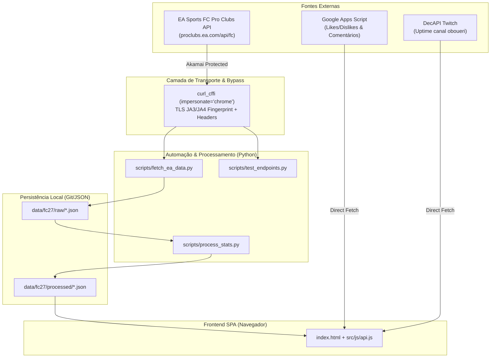

# 📖 Guia Técnico de Endpoints e Integrações Externas — EA FC 27 Pro Clubs & Baile de Munique

> **Documento de Referência Arquitetural e Especificação de APIs**  
> **Projeto**: Baile de Munique (`site-bm`)  
> **Fontes Consultadas**: Discussão técnica da comunidade EA FC 27 ([Reddit r/fifaclubs](https://www.reddit.com/r/fifaclubs/comments/1wu0u1o/what_changed_in_eas_clubs_api_with_fc_27/)), repositório cliente Python ([`1erkandogan/fc27-clubs-api`](https://github.com/1erkandogan/fc27-clubs-api)), SDK Node/TypeScript ([`alex-jordan547/proclubs-sdk`](https://github.com/alex-jordan547/proclubs-sdk)) e validações ao vivo com `curl_cffi`.

---

## 🧭 1. Visão Geral da Arquitetura de APIs

O portal do **Baile de Munique** depende de dados oficiais de telemetria esportiva providos pela API pública do **EA SPORTS FC Pro Clubs (Clubs)**, além de microsserviços auxiliares (Google Apps Script e DecAPI Twitch):



### Características Fundamentais da API da EA:
1. **Pública e sem Autenticação de Usuário**: Os endpoints são consumidos pela interface web oficial da EA (`proclubs.ea.com`). Não há necessidade de credenciais de login EA, tokens OAuth ou chaves de API secretas.
2. **Proteção Anti-Bot Ativa (Akamai Edge)**: A EA utiliza o Akamai Bot Manager. Requisições HTTP convencionais (como `requests` padrão em Python ou `curl` puro) sofrem *connection timeout* ou *HTTP/2 stream reset*. O transporte exige a impersonação do fingerprint TLS do Chrome via biblioteca `curl_cffi`.
3. **Comunicação REST/JSON**: Respostas estruturadas em JSON (ou texto puro nos microsserviços de apoio).

---

## ⚡ 2. O Que Mudou da API do FC 26 para o FC 27

A auditoria das fontes e testes ao vivo confirmaram 6 mudanças e comportamentos fundamentais no ecossistema do FC 27:

| # | Comportamento / Mudança | Impacto Técnico | Tratamento no Projeto |
| :-: | :--- | :--- | :--- |
| **1** | **Descontinuação da geração legada (`common-gen4`)** | PS4 e Xbox One foram descontinuados na API do FC 27. Qualquer requisição com `platform=common-gen4` retorna imediatamente **HTTP 400 Bad Request** (`{"error": "Invalid query parameter: platform"}`). | O projeto adota estritamente `platform=common-gen5` (PS5, Xbox Series X\|S, PC) em `config/fc27/club.json`. |
| **2** | **Reset Global de IDs de Clube** | Os identificadores numéricos (`clubId`) da temporada do FC 26 não foram preservados no FC 27. O ID `1071934` do FC 26 não é válido no FC 27. | O script `fetch_ea_data.py` e a suite de testes implementam **Auto-Discovery por Nome** (`/allTimeLeaderboard/search?clubName=...`), salvando o novo ID em `config/fc27/club.json`. |
| **3** | **Playoffs Inativos retornam HTTP 500** | Fora da janela quinzenal/mensal de Playoffs, o endpoint `/clubs/matches?matchType=playoffMatch` retorna **HTTP 500 Internal Server Error** em vez de lista vazia. | Tratamento defensivo implementado: se `status_code == 500` e a URL contiver `playoffMatch`, a aplicação captura graciosamente e retorna `[]` sem falhar o pipeline. |
| **4** | **Codificação de Códigos de Região** | Códigos de região como `5456205` ou `1396788530` representam sequências ASCII compactadas numericamente (ex: `SEU` = Southern Europe, `EUS` = Eastern US). | Mantidos intactos nos payloads de `data/fc27/raw/` sem decodificação destrutiva. |
| **5** | **Namespace em Partidas Amistosas** | Em partidas do tipo `friendlyMatch`, o campo `namespace` do jogador retorna `0`, enquanto em `leagueMatch` e `playoffMatch` o ID de namespace original da plataforma é preservado. | O processador de partidas indexa primariamente pelo `proId` / `name` do atleta, tornando o parsing imune a variações de `namespace`. |
| **6** | **Handshake TLS com Impersonação Chrome** | O Akamai Bot Manager bloqueia clientes com assinaturas TLS diferentes de browsers reais. | Uso obrigatório de `curl_cffi` com `impersonate="chrome"` em todas as chamadas Python. |

---

## 🛡️ 3. Camada de Transporte, Headers e Proteção Anti-Bot

### 3.1 Por que o Python `requests` Padrão Falha?
Bibliotecas HTTP convencionais (como `urllib3` e `requests`) enviam um pacote *Client Hello* com conjuntos de cifras (ciphersuites) e extensões TLS típicos de scripts. O Akamai Edge da EA detecta essa discrepância e simplesmente descarta os pacotes TCP (*Drop/Read Timeout* de 10 a 25 segundos).

### 3.2 Solução Implementada (`curl_cffi`)
O `curl_cffi` utiliza a biblioteca C `libcurl-impersonate`, replicando perfeitamente a impressão digital TLS (JA3/JA4) e as configurações de HTTP/2 do Google Chrome para desktop:

```python
from curl_cffi import requests

headers = {
    "Accept": "application/json, text/plain, */*",
    "Referer": "https://www.ea.com/",
    "Origin": "https://www.ea.com"
}

# Impersonação nativa do navegador Chrome:
resposta = requests.get(url, impersonate="chrome", timeout=15, headers=headers)
```

---

## 📚 4. Catálogo Completo de Endpoints da EA Sports FC 27

A URL base canônica para todos os endpoints de Pro Clubs é:
```
https://proclubs.ea.com/api/fc
```

### 4.1. Busca de Clubes por Nome (`/allTimeLeaderboard/search`)
Pesquisa clubes cadastrados na base global por termo de busca aproximado ou exato.

- **Método**: `GET`
- **Path**: `/allTimeLeaderboard/search`
- **Query Params**:
  - `platform` *(obrigatório)*: `common-gen5` (ou `switch`)
  - `clubName` *(obrigatório)*: Nome do clube codificado na URL (ex: `urllib.parse.quote("Baile")`)
- **Exemplo de URL**:
  ```
  https://proclubs.ea.com/api/fc/allTimeLeaderboard/search?platform=common-gen5&clubName=BAILE%20D%20MUNIQUE
  ```
- **Formato da Resposta (`HTTP 200`)**:
  ```json
  [
    {
      "clubId": "52589",
      "wins": "11",
      "losses": "2",
      "ties": "1",
      "gamesPlayed": "14",
      "gamesPlayedPlayoff": "0",
      "goals": "56",
      "goalsAgainst": "28",
      "cleanSheets": "2",
      "points": "23",
      "reputationtier": "0",
      "promotions": "2",
      "relegations": "0",
      "bestDivision": "4",
      "currentDivision": "4",
      "platform": "common-gen5",
      "clubName": "BAILE D MUNIQUE",
      "clubInfo": {
        "name": "BAILE D MUNIQUE",
        "clubId": 52589,
        "regionId": 5456205,
        "teamId": 21,
        "customKit": {
          "stadName": "Estádio de ní",
          "crestAssetId": "99160828"
        }
      }
    }
  ]
  ```
- **Caso de Borda**: Se o clube não existir, a API retorna `[]` (lista vazia com `HTTP 200`).

---

### 4.2. Informações Gerais e Configuração do Clube (`/clubs/info`)
Recupera metadados estéticos, estádio, kits customizados e divisões do clube.

- **Método**: `GET`
- **Path**: `/clubs/info`
- **Query Params**:
  - `platform`: `common-gen5`
  - `clubIds`: ID numérico do clube (ex: `52589`)
- **Exemplo de URL**:
  ```
  https://proclubs.ea.com/api/fc/clubs/info?platform=common-gen5&clubIds=52589
  ```
- **Formato da Resposta (`HTTP 200`)**:
  Dicionário indexado pelo ID do clube:
  ```json
  {
    "52589": {
      "name": "BAILE D MUNIQUE",
      "clubId": 52589,
      "regionId": 5456205,
      "teamId": 21,
      "customKit": {
        "stadName": "Estádio de ní",
        "kitColor1": "15921906",
        "crestAssetId": "99160828"
      }
    }
  }
  ```

---

### 4.3. Estatísticas Consolidadas do Clube (`/clubs/overallStats`)
Fornece métricas históricas de desempenho geral da equipe em ligas e divisões.

- **Método**: `GET`
- **Path**: `/clubs/overallStats`
- **Query Params**:
  - `platform`: `common-gen5`
  - `clubIds`: ID numérico do clube
- **Formato da Resposta (`HTTP 200`)**:
  Lista de objetos de estatísticas:
  ```json
  [
    {
      "clubId": "52589",
      "bestDivision": "4",
      "bestFinishGroup": "0",
      "gamesPlayed": "14",
      "gamesPlayedPlayoff": "0",
      "goals": "56",
      "goalsAgainst": "28",
      "wins": "11",
      "losses": "2",
      "ties": "1",
      "points": "23",
      "reputationtier": "0",
      "promotions": "2",
      "relegations": "0"
    }
  ]
  ```

---

### 4.4. Estatísticas dos Membros do Clube (`/members/stats`)
Endpoint vital para a tela de **Elenco** e rankings de **Artilharia, Assistências, MVPs e Notas Médias**.

- **Método**: `GET`
- **Path**: `/members/stats`
- **Query Params**:
  - `platform`: `common-gen5`
  - `clubId`: ID numérico do clube (atenção: singular `clubId`)
- **Exemplo de URL**:
  ```
  https://proclubs.ea.com/api/fc/members/stats?platform=common-gen5&clubId=52589
  ```
- **Formato da Resposta (`HTTP 200`)**:
  ```json
  {
    "members": [
      {
        "name": "Thiago_Souza108",
        "proName": "THIAGO",
        "proPos": "midfielder",
        "favoritePosition": "midfielder",
        "proOverall": "88",
        "gamesPlayed": "14",
        "goals": "12",
        "assists": "8",
        "cleanSheetsDef": "2",
        "cleanSheetsGK": "0",
        "ratingAve": "8.4",
        "winRate": "78",
        "manOfTheMatch": "4",
        "passesMade": "210",
        "passSuccessRate": "84",
        "tacklesMade": "35",
        "tackleSuccessRate": "68",
        "shotSuccessRate": "45",
        "redCards": "0",
        "prevGoals0": "1",
        "prevGoals1": "2",
        "prevGoals2": "0"
      }
    ],
    "positionCount": {
      "midfielder": 3,
      "forward": 2,
      "defender": 2,
      "goalkeeper": 1
    }
  }
  ```

---

### 4.5. Histórico e Telemetria de Partidas (`/clubs/matches`)
Armazena a telemetria completa de cada partida disputada com desdobramento por equipe e atleta.

- **Método**: `GET`
- **Path**: `/clubs/matches`
- **Query Params**:
  - `platform`: `common-gen5`
  - `clubIds`: ID numérico do clube
  - `matchType`: `leagueMatch` | `playoffMatch` | `friendlyMatch`
  - `maxResultCount`: Número de registros (padrão: `50`)
- **Exemplo de URL**:
  ```
  https://proclubs.ea.com/api/fc/clubs/matches?platform=common-gen5&clubIds=52589&matchType=leagueMatch&maxResultCount=50
  ```
- **Formato da Resposta (`HTTP 200`)**:
  Lista de partidas ordenadas por timestamp:
  ```json
  [
    {
      "matchId": "1730512800123",
      "timestamp": 1730512800,
      "timeAgo": {
        "number": 2,
        "unit": "hours"
      },
      "clubs": {
        "52589": {
          "date": "1730512800",
          "goals": "3",
          "goalsAgainst": "1",
          "result": "1",
          "score": "3",
          "TEAM": "52589"
        },
        "999999": {
          "goals": "1",
          "goalsAgainst": "3",
          "result": "2",
          "score": "1",
          "TEAM": "999999"
        }
      },
      "players": {
        "52589": {
          "Thiago_Souza108": {
            "goals": "2",
            "assists": "1",
            "rating": "9.1",
            "passesmade": "28",
            "passSuccessRate": "88",
            "tacklesmade": "4"
          }
        }
      }
    }
  ]
  ```

---

## 🌐 5. Outros Endpoints Integrados ao Baile de Munique

Além da EA Sports, o site consome outros dois microsserviços:

### 5.1. Google Apps Script (Likes, Dislikes & Comentários)
- **Endpoint**:
  ```
  https://script.google.com/macros/s/AKfycbyBH4hq66XZuuHoKQtaoyTGCP3M2WbYNwJlRF0Qw8V40iMmHaZA82vmJFkABZALHSFrTg/exec
  ```
- **Consulta (`GET ?editionId=...`)**:
  - Resposta (`HTTP 200`):
    ```json
    {
      "likes": 12,
      "dislikes": 1,
      "comments": [
        {
          "id": "c_1730512999",
          "author": "Torcedor Fiel",
          "text": "Jogão ontem!",
          "timestamp": "2026-11-01T20:30:00Z"
        }
      ]
    }
    ```
- **Envio (`POST`)**: Envia dados via payload para registrar interações no Google Sheets.

### 5.2. DecAPI Twitch (Uptime e Status da Stream de `oboueri`)
- **Endpoint**:
  ```
  https://decapi.me/twitch/uptime/oboueri
  ```
- **Consulta (`GET`)**: Retorna string simples com status da live:
  - Offline: `"oboueri is offline"` (detectado via `text.toLowerCase().includes('offline')`)
  - Ao vivo: `"1 hour, 25 minutes"` (ativa o botão flutuante pulsante `.floating-live-btn` na SPA).
  - Fallback manual: configurável via `"ao_vivo": true` em `config/fc27/club.json`.

---

## 🛠️ 6. Scripts Operacionais e Diagnóstico via Terminal

Criamos um utilitário dedicado de diagnóstico com relatório em tempo real:

### 6.1 Como Executar:
```bash
# Diagnóstico completo padrão (FC 27)
python scripts/test_endpoints.py

# Diagnóstico com saída detalhada dos payloads
python scripts/test_endpoints.py --verbose

# Testar busca com outro termo ou nome de clube
python scripts/test_endpoints.py --club "BAILE D MUNIQUE"

# Testar diretamente via Bateria de Testes 04
python tests/test_04_endpoints_diagnostic.py
```

### 6.2 O Que o Script Executa Automaticamente:
1. **Verificação de Bypass Akamai**: Testa handshake TLS e valida tempo de resposta (< 200ms).
2. **Rejeição de Plataforma Legada**: Confirma que `common-gen5` passa e `common-gen4` é barrado com HTTP 400.
3. **Busca de Variações de Nomes**: Testa o nome configurado em `club.json`, variações maiúsculas, variações de digitação e termos inexistentes.
4. **Resolução Dinâmica do Clube**: Obtém o `clubId` e testa `info`, `overallStats`, `members/stats`, `members/career/stats` e partidas (`league`, `playoff`, `friendly`).
5. **Teste de Microsserviços**: Valida Google Apps Script e status da Twitch.
6. **Gravação de Logs**: Salva todo o histórico de execuções com timestamp em `logs/diagnostic_endpoints.log`.

---

## 📋 7. Proposta de Plano de Testes de Endpoints

Para a governança contínua do projeto, propomos a seguinte matriz de casos de teste:

| ID | Cenário de Teste | Endpoint Testado | Entrada / Condição | Resultado Esperado | Severidade |
| :-: | :--- | :--- | :--- | :--- | :-: |
| **TC-01** | Validação Anti-Bot & TLS | `/clubs/overallStats` | `curl_cffi` com `chrome` | HTTP 200 e latência < 2000ms | Crítica |
| **TC-02** | Rejeição Gen4 Legada | `/clubs/overallStats` | `platform=common-gen4` | HTTP 400 (`Invalid query parameter`) | Média |
| **TC-03** | Auto-Discovery de Clube | `/allTimeLeaderboard/search` | `clubName=Baile` ou `BAILE D MUNIQUE` | HTTP 200 com array e pelo menos 1 clube | Crítica |
| **TC-04** | Clube Inexistente | `/allTimeLeaderboard/search` | `clubName=Inexistente_123` | HTTP 200 com array vazio `[]` | Alta |
| **TC-05** | Schema de Membros | `/members/stats` | `clubId` válido | HTTP 200 com chaves `"members"` e `"positionCount"` | Crítica |
| **TC-06** | Partidas de Liga | `/clubs/matches` | `matchType=leagueMatch` | HTTP 200 com lista de partidas e chaves `matchId`, `clubs`, `players` | Crítica |
| **TC-07** | Playoffs Inativos (Borda) | `/clubs/matches` | `matchType=playoffMatch` | HTTP 200 ou HTTP 500 tratado defensivamente como `[]` | Alta |
| **TC-08** | Amistosos | `/clubs/matches` | `matchType=friendlyMatch` | HTTP 200 com lista (aceitando `namespace=0`) | Média |
| **TC-09** | Reações e Comentários | Google Apps Script | `editionId=edicao35` | HTTP 200 com `likes`, `dislikes` e `comments` | Alta |
| **TC-10** | Status Twitch Live | DecAPI Twitch | `channel=oboueri` | HTTP 200 com string indicando online/offline | Média |

---

*Guia homologado pela equipe de desenvolvimento e inteligência do Baile de Munique FC.*
